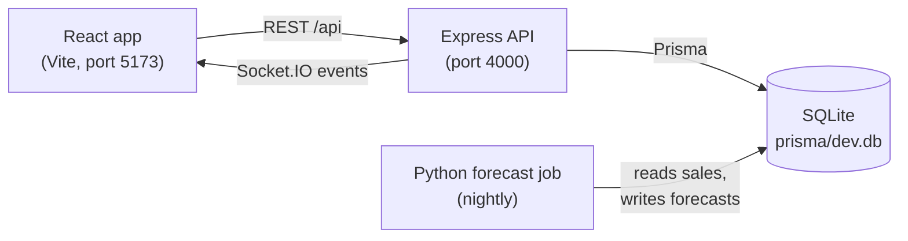

# InventoryOS

Real-time inventory management and demand forecasting for a company with several warehouses.

Every stock movement is recorded in an append-only ledger, dashboards update live as stock
changes, managers get low-stock alerts, stock moves between warehouses through an approval
flow, and a nightly forecasting job turns 12 months of sales into reorder advice that explains
itself.


## Contents

- [Features](#features)
- [Tech stack](#tech-stack)
- [Architecture](#architecture)
- [Getting started](#getting-started)
- [Demo data and logins](#demo-data-and-logins)
- [Roles](#roles)
- [How forecasting works](#how-forecasting-works)
- [Project structure](#project-structure)
- [Scripts](#scripts)
- [Testing and CI](#testing-and-ci)
- [API](#api)
- [Known issues](#known-issues)

## Features

- **Stock movements**: stock in, purchases, sales, returns, stock out and stock-count
  adjustments, per product and warehouse. Stock can never go negative, even under
  concurrent requests.
- **Append-only ledger**: every quantity change writes an `InventoryTransaction` row in the
  same database transaction. A database trigger blocks edits and deletes, and a consistency
  check proves that each stock level equals the sum of its ledger rows.
- **Warehouse transfers**: `REQUESTED → APPROVED → IN_TRANSIT → RECEIVED`, cancellable before
  dispatch. Stock leaves the source on dispatch (all items or none) and arrives on receive,
  with a full who-and-when timeline.
- **Live updates**: Socket.IO pushes stock changes, new activity, transfer updates and alerts
  to the right users, warehouses and roles, only after the database change has committed.
- **Low-stock alerts**: admins and managers are notified when a product crosses its reorder
  level, with a separate alert when it runs out.
- **Valuation**: weighted-average cost, recomputed on every receipt. Money is handled as
  decimals end to end, never as floating-point numbers.
- **Analytics**: valuation, turnover, movement, fast movers, slow movers and dead stock, with
  date and warehouse filters.
- **Demand forecasting**: a 30-day forecast per product, with the model chosen by backtest,
  plus reorder recommendations (how much to order and how urgently).
- **Security**: role-based access checked on every route, short-lived access tokens with
  rotating refresh tokens and reuse detection, CSRF protection on cookie endpoints, rate
  limiting, idempotency keys on stock-changing requests, and an audit log of admin changes.

## Tech stack

| Part | Folder | Stack |
| --- | --- | --- |
| API | `backend/` | Node.js 24, Express 5, TypeScript, Prisma 7, SQLite, Socket.IO, Zod |
| Forecasting job | `backend/forecasting/` | Python 3.11, pandas, statsmodels |
| Web app | `frontend/` | React 19, Vite, TypeScript, Tailwind CSS 4, shadcn/ui, TanStack Query and Table, Recharts |

Tooling: Vitest and pytest for tests, oxlint for linting, Prettier for formatting, GitHub
Actions for CI.

## Architecture



The backend is layered: **routes → controllers (thin) → services (all business logic) →
Prisma**. Every route runs `authenticate → authorize(role) → validate(Zod)` before reaching a
controller.

The forecasting job is a batch script, not a running service: it reads the sales history
from the same SQLite file and writes one `Forecast` row per product. The API then serves the
latest forecast and computes recommendations from it.

## Getting started

### Prerequisites

- Node.js 24 and npm 11
- Python 3.11 (only for forecasting)
- Git

The commands below are for Windows. On macOS or Linux, use `cp` instead of `copy` and
`.venv/bin/` instead of `.venv\Scripts\`.

### 1. Clone

```bash
git clone https://github.com/ROG-user-0987/FSD_PROJECT.git
cd FSD_PROJECT
```

### 2. Backend

```bash
cd backend
npm install
copy .env.example .env
```

Open `backend/.env` and set at least these values:

| Variable | What to put |
| --- | --- |
| `JWT_ACCESS_SECRET` | A random string of 32+ characters. Generate one with `node -e "console.log(require('crypto').randomBytes(48).toString('base64url'))"` |
| `SEED_ADMIN_PASSWORD` | Password for the first admin (10 to 72 characters) |
| `SEED_DEMO_PASSWORD` | Password for all demo users. Leave empty to reuse the admin password. |

Then create the database, load the demo data and start the API:

```bash
npx prisma migrate deploy     # creates prisma/dev.db
npm run seed                  # admin, demo users and 12 months of history (about 15 s)
npm run dev                   # http://localhost:4000/api
```

### 3. Forecasts (run once after seeding)

```bash
cd backend/forecasting
python -m venv .venv
.venv\Scripts\pip install -r requirements.txt
.venv\Scripts\python forecast.py
```

Without this step the app still works, but the Forecasts page and the product charts have no
forecast data.

### 4. Frontend (in a second terminal)

```bash
cd frontend
npm install
npm run dev                   # http://localhost:5173
```

Open http://localhost:5173 and sign in with one of the logins printed by the seed.

The frontend reads the API address from `VITE_API_URL` and `VITE_SOCKET_URL`. The defaults
point to `localhost:4000`; copy `frontend/.env.example` to `frontend/.env` only if you need
different values.

### Starting over

Stop the API, delete `backend/prisma/dev.db*`, then run `npx prisma migrate deploy`,
`npm run seed` and the forecast job again.

## Demo data and logins

`npm run seed` simulates 12 months of a realistic business:

- 128 products in 8 categories from 10 suppliers
- 5 warehouses: Hyderabad, Bangalore, Mumbai, Chennai and Delhi
- About 94,000 transactions, with weekly seasonality, festival peaks, slow movers, dead
  stock, supplier lead times, missed reorders and stockouts, returns, stock-count
  adjustments, and transfers in every status

At the end, the seed runs the consistency check (every stock level must equal the sum of its
ledger rows) and prints the demo logins:

- **Admin**: the email and password from `SEED_ADMIN_EMAIL` and `SEED_ADMIN_PASSWORD`
- **Managers** (2), **one employee per warehouse**, and **a viewer**, all using
  `SEED_DEMO_PASSWORD`

Sign in as different roles to see how the app changes.

## Roles

There is no public sign-up: the admin creates users.

| Role | Can do |
| --- | --- |
| **Admin** | Everything, including users, warehouses, reorder levels, the audit log and the consistency check |
| **Manager** | Catalogue (products, categories, suppliers), stock movements and adjustments, approving transfers, analytics and forecasts |
| **Employee** | Works in one warehouse: stock in and out, requesting, dispatching and receiving transfers |
| **Viewer** | Read-only: dashboard, products, inventory and analytics |

The frontend hides what a role cannot use, but the backend enforces every rule again,
including row-level rules such as employees only seeing their own warehouse.

## How forecasting works

`backend/forecasting/forecast.py` runs these steps for each product:

1. **Daily sales**: sums `SALE` units per day across all warehouses.
2. **Stockout days**: replays the ledger to find days when the product was out of stock.
   Those days are treated as *unknown* demand, not zero demand, so stockouts don't make the
   forecast too low.
3. **Model selection**: backtests each candidate model over the last 4 periods of 14 days
   and picks the one with the lowest WAPE (weighted absolute percentage error):

   | Model | Used for |
   | --- | --- |
   | `seasonal_naive_7` | Same weekday last week. Always computed as the baseline. |
   | `moving_average_28` | Average of the last 28 observed days |
   | `ets` | Holt-Winters with weekly seasonality, with 8+ weeks of data |
   | `ses` | Simple exponential smoothing, for shorter histories |
   | `croston_sba` | Sparse demand (more than 60% zero days) |

4. **Output**: writes a 30-day forecast, the chosen model, its WAPE and the baseline's WAPE
   to the `Forecast` table. Products with fewer than 28 days of history are skipped.

The API turns each forecast into a **reorder recommendation** using the supplier's lead time:

```
safety stock    = 1.65 × daily demand std dev × √(lead time)       (about 95% service level)
reorder point   = average daily demand × lead time + safety stock
recommended qty = max(0, demand over lead time + review period + safety stock − stock on hand)
urgency         = ORDER_NOW (at or below reorder point) · SOON (stockout expected soon) · OK
```

Stock on hand includes stock in transit between warehouses.

## Project structure

```
.
├── backend/
│   ├── src/
│   │   ├── config/         env, logger, Prisma client, database triggers
│   │   ├── routes/         URL → middleware → controller
│   │   ├── controllers/    thin request/response handling
│   │   ├── services/       all business logic (inventory, transfers, reorder, ...)
│   │   ├── middleware/     auth, roles, validation, idempotency, rate limits, errors
│   │   ├── validators/     Zod schemas
│   │   ├── socket/         Socket.IO setup and events
│   │   └── server.ts
│   ├── prisma/             schema.prisma, migrations/, seed.ts
│   ├── forecasting/        Python forecast job and its tests
│   ├── tests/              Vitest API tests
│   └── docs/API.md         full API reference
├── frontend/
│   └── src/
│       ├── pages/          one page per route
│       ├── components/     app components; ui/ is generated by shadcn
│       ├── hooks/          auth, live updates, lookups, ...
│       ├── services/       API client, query keys, socket
│       └── App.tsx         routes
└── .github/workflows/ci.yml
```

## Scripts

**Backend** (`cd backend`)

| Command | Does |
| --- | --- |
| `npm run dev` | Start the API with auto-reload |
| `npm run build` / `npm start` | Compile to `dist/` / run the compiled API |
| `npm run seed` | Load demo data into an empty database |
| `npm run db:deploy` | Apply migrations |
| `npm run db:migrate` | Create a new migration after editing the schema |
| `npm test` | Run the tests |
| `npm run lint` · `typecheck` · `format` · `format:check` | Code quality |

**Frontend** (`cd frontend`)

| Command | Does |
| --- | --- |
| `npm run dev` | Start the dev server |
| `npm run build` / `npm run preview` | Production build / preview it |
| `npm test` | Run the tests |
| `npm run lint` · `typecheck` · `format` · `format:check` | Code quality |

**Forecasting** (`cd backend/forecasting`)

| Command | Does |
| --- | --- |
| `.venv\Scripts\python forecast.py` | Generate forecasts |
| `.venv\Scripts\python -m pytest` | Run the tests |

## Testing and CI

Run every check locally:

```bash
cd backend  && npm run format:check && npm run lint && npm run typecheck && npm test && npm run build
cd frontend && npm run format:check && npm run lint && npm run typecheck && npm test && npm run build
cd backend/forecasting && .venv\Scripts\python -m pytest
```

Backend tests run against a separate `prisma/test.db` that is recreated on every run. They
cover authentication, role permissions, security rules, stock movements (including
concurrent requests), the transfer state machine, reorder logic, database guards and socket
events.

GitHub Actions runs the same checks on every push and pull request to `main`.

## API

All endpoints are under `/api` and return JSON. Protected endpoints need an
`Authorization: Bearer <accessToken>` header; the access token comes from
`POST /api/auth/login`. See [`backend/docs/API.md`](backend/docs/API.md) for every endpoint,
its roles and parameters, the error format and the Socket.IO events.

Quick check that the API is running:

```bash
curl http://localhost:4000/api/health
```

## Known issues

- **Windows test crashes**: Vitest's worker process sometimes crashes natively on Windows
  (exit code `3221226505`) in the longer stock test files. It is a test-runner issue, not an
  app bug; re-run the tests. CI runs on Linux and is not affected.
- **Deployment**: SQLite needs a persistent disk, so hosts with temporary file systems (such
  as Render's free tier) will lose the data on restart.
- **Forecast scheduling**: the forecast job is run by hand; there is no scheduler yet.
