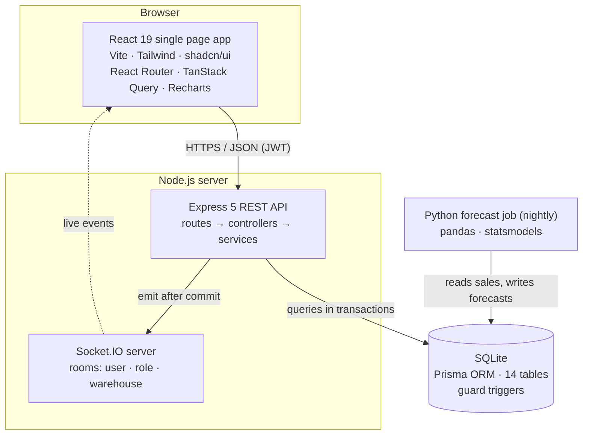
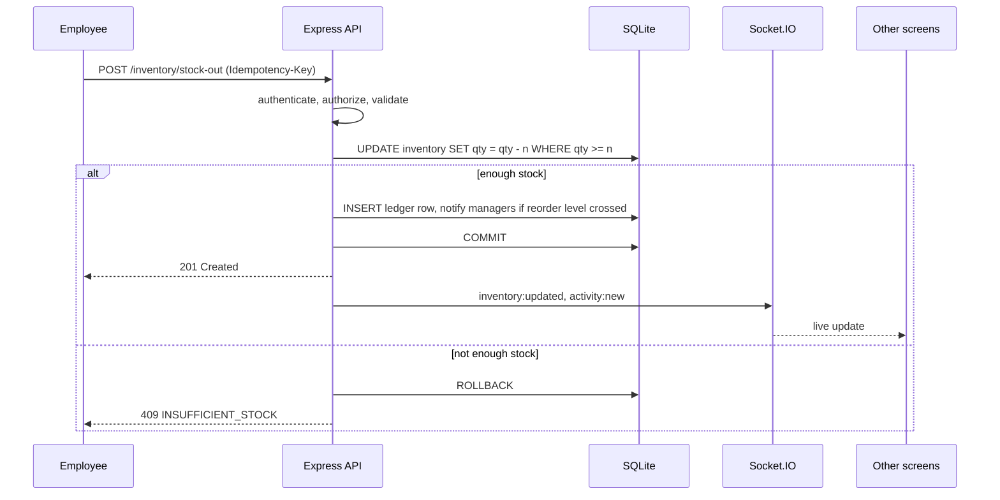
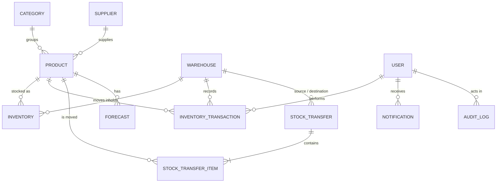
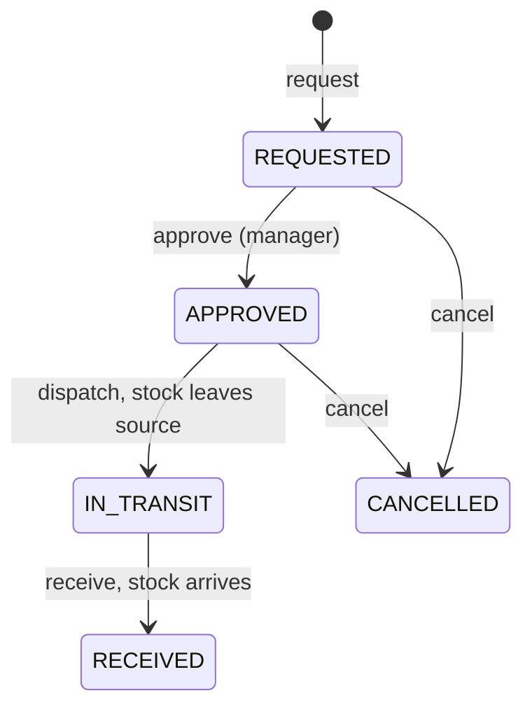

# InventoryOS

**Real-time inventory management and demand forecasting for a company with multiple warehouses.**

InventoryOS tracks every unit of stock in every warehouse and records every stock movement in a permanent, append-only ledger. Every open screen updates live. Stock moves between warehouses through an approval workflow, managers are alerted when stock runs low, and a nightly forecasting job turns 12 months of sales into reorder recommendations that explain their reasoning.


Built by **Sriram Aditya Sai**.


---

## Contents

- [InventoryOS](#inventoryos)
  - [Contents](#contents)
  - [Why InventoryOS](#why-inventoryos)
  - [Features](#features)
  - [Screenshots](#screenshots)
    - [Dashboard: KPIs, movement chart and live activity](#dashboard-kpis-movement-chart-and-live-activity)
    - [Dashboard: value by warehouse, stock by category, fast movers, items needing attention](#dashboard-value-by-warehouse-stock-by-category-fast-movers-items-needing-attention)
    - [Inventory: every product in every warehouse](#inventory-every-product-in-every-warehouse)
    - [Products: catalogue with prices, average cost and total stock](#products-catalogue-with-prices-average-cost-and-total-stock)
    - [Transactions: the append-only stock ledger](#transactions-the-append-only-stock-ledger)
    - [Warehouses: value, units and stock health per site](#warehouses-value-units-and-stock-health-per-site)
    - [Suppliers: contacts, lead times and ratings](#suppliers-contacts-lead-times-and-ratings)
    - [Forecasts: urgency summary and per-product reorder advice](#forecasts-urgency-summary-and-per-product-reorder-advice)
    - [Audit log and ledger consistency check](#audit-log-and-ledger-consistency-check)
  - [Roles and permissions](#roles-and-permissions)
  - [Tech stack](#tech-stack)
  - [Architecture](#architecture)
  - [Database design](#database-design)
  - [Correctness rules](#correctness-rules)
  - [Stock transfer workflow](#stock-transfer-workflow)
  - [Real-time updates](#real-time-updates)
  - [Demand forecasting and reorder recommendations](#demand-forecasting-and-reorder-recommendations)
  - [API overview](#api-overview)
  - [Security](#security)
  - [Project structure](#project-structure)
  - [Getting started](#getting-started)
    - [Prerequisites](#prerequisites)
    - [1. Backend (http://localhost:4000/api)](#1-backend-httplocalhost4000api)
    - [2. Forecasts (once after seeding, then nightly)](#2-forecasts-once-after-seeding-then-nightly)
    - [3. Frontend (http://localhost:5173)](#3-frontend-httplocalhost5173)
  - [Environment variables](#environment-variables)
  - [Scripts](#scripts)
  - [Demo data](#demo-data)
  - [Testing](#testing)
  - [Results](#results)
  - [Known limitations](#known-limitations)
  - [Roadmap](#roadmap)
  - [Acknowledgements](#acknowledgements)

---

## Why InventoryOS

Small and mid-sized businesses often track stock in spreadsheets or basic billing apps. Once they have several warehouses and several people changing stock during the day, four things go wrong:

| Problem | What InventoryOS does |
|---|---|
| **Counts drift.** Numbers are overwritten, so nobody can explain how stock got there. | Every change is a ledger row that can never be edited, and a consistency check proves the numbers. |
| **No shared view across warehouses.** Transfers between sites go untracked. | Stock is tracked per warehouse, and transfers follow a request → approve → dispatch → receive workflow. |
| **Stockouts are noticed too late.** | Managers get live alerts the moment stock crosses its reorder level. |
| **Reordering is guesswork.** | A forecasting job recommends how much to order, using demand trends and supplier lead times. |

It also solves the hard technical cases: two people selling the last unit at the same moment, network retries that could apply a change twice, stock that's in transit between warehouses, and forecasts that would otherwise be fooled by out-of-stock days.

> InventoryOS is **not** an online store (no storefront, cart or payments). It serves **one company** with several warehouses.

---

## Features

**Inventory**
- Stock per product per warehouse, with quantity, reorder level, value and an In stock / Low stock / Out of stock status.
- Stock in, stock out and stock-count adjustments, each recorded with a reason and reference.
- Search by name or SKU; filter by warehouse, category, supplier and status; sort; paginate on the server.
- Rows flash when stock changes, with no refresh needed.

**Transfers**
- Multi-item transfers between warehouses with a status timeline.
- Stock leaves the source on dispatch and arrives at the destination on receipt.
- Action buttons depend on your role and the transfer's status.

**Dashboard and analytics**
- 8 live KPI cards: inventory value, units in stock, low stock, out of stock, outgoing units (30 days), in transit, products, warehouses.
- Inventory movement chart, live recent-activity feed, value by warehouse, stock by category, fast movers, items needing attention.
- Reports: valuation, turnover, stock movement, fast-moving, slow-moving and dead stock.

**Forecasting**
- 30-day demand forecast per product, with the best model chosen by backtesting.
- Each forecast's error is shown next to a simple baseline, so you can see whether the model helps.
- Reorder quantity and urgency (Order now / Order soon / OK), with a plain-English explanation.

**Administration**
- Four roles enforced on the server for every route.
- User and warehouse management, supplier catalogue with lead times and ratings.
- Audit log of admin changes and a one-click ledger consistency check.
- Notification bell, toasts, light and dark theme.

---

## Screenshots

All screenshots use the seeded demo data, signed in as the System Admin, in dark theme.

### Dashboard: KPIs, movement chart and live activity


### Dashboard: value by warehouse, stock by category, fast movers, items needing attention


### Inventory: every product in every warehouse


### Products: catalogue with prices, average cost and total stock


### Transactions: the append-only stock ledger


### Warehouses: value, units and stock health per site


### Suppliers: contacts, lead times and ratings


### Forecasts: urgency summary and per-product reorder advice


### Audit log and ledger consistency check


---

## Roles and permissions

Permissions are enforced on the **backend** for every route. The frontend only hides what a role can't use.

| Capability | Admin | Manager | Employee | Viewer |
|---|:---:|:---:|:---:|:---:|
| Manage users and warehouses | ✅ | | | |
| Manage products and suppliers | ✅ | ✅ | | |
| Change a product's reorder level | ✅ | | | |
| Stock in / stock out | ✅ | ✅ | Own warehouse | |
| Stock adjustment | ✅ | ✅ | | |
| Request a transfer | ✅ | ✅ | From own warehouse | |
| Approve a transfer | ✅ | ✅ | | |
| Dispatch / receive a transfer | ✅ | ✅ | Own warehouse | |
| View transactions | ✅ | ✅ | Own warehouse | |
| Dashboard and analytics | ✅ | ✅ | | ✅ |
| Forecasts and reorder advice | ✅ | ✅ | | |
| Audit log and consistency check | ✅ | | | |

There is no public sign-up: the seeded admin creates every other user.

---

## Tech stack

| Layer | Technology | Used for |
|---|---|---|
| **Frontend** | React 19, TypeScript, Vite | Single page application and build tool |
| Styling and UI | Tailwind CSS 4, shadcn/ui (Radix), lucide-react | Layout, components, light/dark theme |
| Routing | React Router 8 | Client-side routes protected by role |
| Data fetching | TanStack Query 5 | API calls, caching, live refresh |
| Tables | TanStack Table 8 | Search, filters, sorting, pagination |
| Forms | React Hook Form + Zod | Validated dialogs |
| Charts | Recharts | Dashboard, analytics and forecast charts |
| Toasts | sonner | Notifications in the UI |
| Real-time client | socket.io-client | Live updates |
| **Backend** | Node.js 24, Express 5, TypeScript | REST API and business logic |
| Real-time server | Socket.IO 4 | Live events in rooms per user, role and warehouse |
| Validation | Zod | Every request body and query |
| Auth and security | JWT, bcrypt, helmet, cors, express-rate-limit, cookie-parser | Sessions, password hashing, HTTP headers, abuse limits |
| Logging | pino | Structured server logs |
| Money | decimal.js (Prisma Decimal) | Exact rupee and cost arithmetic |
| **Database** | SQLite + Prisma 7 (better-sqlite3 adapter) | 14 tables, migrations, guard triggers |
| **Forecasting** | Python 3.11, pandas, NumPy, statsmodels | Nightly demand forecast job |
| **Testing** | Vitest, Supertest, pytest | Backend, frontend and Python tests |
| Code quality | oxlint, Prettier, TypeScript | Lint, format, type checks |
| CI | GitHub Actions | Checks on every push to `main` and on pull requests |

The project deliberately doesn't use Redis, Docker, Cloudinary or email.

---

## Architecture



**Request pipeline:** rate limit, helmet and CORS → `authenticate` (JWT) → `authorize` (role group) → `validate` (Zod, unknown fields dropped) → controller (thin) → service (all business logic) → Prisma `$transaction` → SQLite. Socket.IO events are sent only **after** the transaction commits.



---

## Database design

**Stock is never stored on the product.** Each product has one `Inventory` row per warehouse, and every change to that quantity is written to the `InventoryTransaction` ledger in the same database transaction.



| Table | Purpose | Key rules |
|---|---|---|
| `User` | Staff accounts and roles | Unique email; bcrypt hash; an employee belongs to exactly one warehouse |
| `RefreshToken` | Login sessions | Stored as SHA-256 hashes, rotated on every refresh |
| `Category` | Product groups | Unique name |
| `Supplier` | Vendors | Lead time in days (drives reorder advice), rating 0–5 |
| `Product` | Catalogue items | Unique SKU, cost and selling price, weighted-average cost, reorder level |
| `Warehouse` | Storage sites | Unique name and code (HYD, BLR, BOM, MAA, DEL) |
| `Inventory` | Stock of one product in one warehouse | Unique (product, warehouse); quantity can never be negative |
| `InventoryTransaction` | The stock ledger | Append-only; signed change; cost frozen at the time; balance after |
| `StockTransfer` | Movement between warehouses | Status workflow; source ≠ destination |
| `StockTransferItem` | Products in a transfer | Quantity > 0; cost frozen at dispatch |
| `Notification` | Low-stock, out-of-stock and transfer alerts | One row per recipient; read/unread |
| `Forecast` | Predicted demand | 30 daily values, chosen model, error vs baseline |
| `AuditLog` | Who changed what | Before and after values of admin actions |
| `IdempotencyRecord` | Safe retries | Unique (user, key); stores the original response |

Transaction types: `STOCK_IN`, `PURCHASE`, `STOCK_OUT`, `SALE`, `RETURN`, `ADJUSTMENT`, `TRANSFER_OUT`, `TRANSFER_IN`.

Rules Prisma can't express are **SQLite triggers**, re-applied on every server start, seed and test run (`backend/src/config/dbGuards.ts`): no negative stock, every employee has a warehouse, and ledger rows can't be updated or deleted.

---

## Correctness rules

Six rules make the data trustworthy. Each one is proven by an automated test.

| # | Rule | How it's enforced |
|---|---|---|
| 1 | Stock never goes negative, even under concurrency | One atomic conditional update inside a transaction; a trigger as a safety net |
| 2 | Every change is recorded and history is immutable | Ledger row in the same transaction; triggers block `UPDATE`/`DELETE`; `GET /api/admin/consistency-check` |
| 3 | A retried request is applied only once | `Idempotency-Key` header: same key and body replays the first response; same key with a different body returns 422 |
| 4 | Stock is valued at weighted-average cost | Average recomputed on receipts; outgoing rows freeze it; value = Σ(quantity × avgCost) |
| 5 | Transfers follow a strict workflow | State machine plus a conditional status update; invalid steps return 409 |
| 6 | Alerts fire once, when stock crosses the reorder level | Compare before and after; a separate out-of-stock alert at 0 |

The heart of rule 1 (`backend/src/services/inventory.service.ts`):

```ts
// The single atomic conditional update: never read-then-write.
const updated = await tx.inventory.updateMany({
  where: { ...pair, quantity: { gte: movement.quantity } },
  data: { quantity: { decrement: movement.quantity } },
})
if (updated.count === 0) throw conflict('INSUFFICIENT_STOCK', `Not enough ${product.sku} in ${warehouse.code}`)
```

---

## Stock transfer workflow



| Step | Who | Effect on stock |
|---|---|---|
| Request | Employee (own warehouse as source), Manager, Admin | None |
| Approve | Manager, Admin | None |
| Dispatch | Source-warehouse employee, Manager, Admin | Leaves the source, all items or none |
| Receive | Destination-warehouse employee, Manager, Admin | Arrives at the destination |
| Cancel | Requester, Manager, Admin | None; only before dispatch |

Stock in transit belongs to no warehouse until it's received, and is shown separately on the dashboard.

---

## Real-time updates

The Socket.IO handshake is authenticated with the access token, and deactivated users are rejected. Connections join rooms `user:{id}`, `role:{ROLE}` and `warehouse:{id}`; employees join only their own warehouse room.

| Event | Sent when | Effect in the browser |
|---|---|---|
| `inventory:updated` | Any stock quantity changes | Inventory, products and dashboard refresh |
| `activity:new` | A ledger row is recorded | Activity feed and transactions refresh |
| `transfer:updated` | A transfer changes status | Transfers refresh and a toast appears |
| `alert:low-stock` | Stock crosses the reorder level | Inventory refreshes |
| `notification:new` | A notification is created | Bell badge updates and a toast appears |
| `dashboard:stale` | Dashboard figures change | Dashboard, analytics, warehouses and forecasts refresh |

One hook (`frontend/src/hooks/useLiveUpdates.ts`) turns these events into TanStack Query cache invalidations, so no page ever needs a manual refresh.

---

## Demand forecasting and reorder recommendations

`backend/forecasting/forecast.py` runs as a batch job, meant to run nightly. It reads the ledger, builds a daily sales series per product, and writes a 30-day forecast to the `Forecast` table.

- **Out-of-stock days are treated as missing, not zero demand.** Otherwise a stockout would teach the model that demand was low.
- **Candidate models:**
  - seasonal naive 7-day, always computed as the **baseline**;
  - 28-day moving average;
  - Holt-Winters exponential smoothing with weekly seasonality (8+ weeks of data);
  - simple exponential smoothing;
  - Croston-SBA for sparse items (more than 60% zero-sale days).
- **Model selection:** rolling backtest over 4 folds of 14 days; the lowest **WAPE** (weighted absolute percentage error) wins.
- Products with fewer than 28 observed days get no forecast and show "not enough history".

The backend turns each forecast into a recommendation (`backend/src/services/reorder.service.ts`):

```text
safetyStock    = ceil(1.65 × σ_daily × √leadTime)          (about 95% service level)
reorderPoint   = ceil(avgDaily × leadTime + safetyStock)
targetCover    = ceil(demand over (leadTime + 7 days) + safetyStock)
recommendedQty = max(0, targetCover − (onHand + inTransit))
urgency        = ORDER_NOW if available ≤ reorderPoint
                 SOON if a stockout is expected within leadTime + 7 days
                 OK otherwise
```

Every recommendation includes an explanation such as: *"Expected demand over the next 13 days is 47 units. Supplier lead time is 5 days. With a safety buffer of 6 units you need 53 units of cover. You have 32. Order 21."*

---

## API overview

Base URL in development: `http://localhost:4000/api`. Successful responses are `{ data, meta? }` and errors are `{ error: { code, message, details? } }`. The full contract is in [`backend/docs/API.md`](backend/docs/API.md).

| Area | Endpoints | Roles |
|---|---|---|
| Health | `GET /health` | Public |
| Auth | `POST /auth/login`, `/auth/refresh`, `/auth/logout`; `GET /auth/me` | Public / any |
| Users | `GET`, `POST /users`; `PUT /users/:id`; `PUT /users/:id/deactivate` | Admin |
| Warehouses | `GET /warehouses`, `/warehouses/:id`; `POST`; `PUT` | All read; Admin writes |
| Categories, suppliers | `GET`, `POST`, `PUT`, `DELETE` | All read; Admin, Manager write |
| Products | `GET /products` (search, filter, sort, page); `GET /products/:id`; `POST`; `PUT`; `DELETE` | All read; Admin, Manager write |
| Inventory | `GET /inventory`; `POST /inventory/stock-in`, `/stock-out`, `/adjust` | Staff (adjust: Admin, Manager) |
| Transactions | `GET /transactions` | Admin, Manager, Employee |
| Transfers | `GET`, `POST /transfers`; `GET /transfers/:id`; `PUT /transfers/:id/approve`, `/dispatch`, `/receive`, `/cancel` | Staff (approve: Admin, Manager) |
| Notifications | `GET /notifications`; `PUT /notifications/:id/read`, `/read-all` | Any signed-in user |
| Dashboard | `GET /dashboard` | Admin, Manager, Viewer |
| Analytics | `GET /analytics/valuation`, `/turnover`, `/movement`, `/fast-moving`, `/slow-moving`, `/dead-stock` | Admin, Manager, Viewer |
| Forecasts | `GET /forecasts`; `GET /forecasts/:productId` | Admin, Manager |
| Admin | `GET /admin/audit-log`, `/admin/consistency-check` | Admin |

Common error codes: `VALIDATION_ERROR` (400), `UNAUTHORIZED` / `TOKEN_EXPIRED` (401), `FORBIDDEN` (403), `NOT_FOUND` (404), `INSUFFICIENT_STOCK` / `INVALID_TRANSITION` (409), `IDEMPOTENCY_KEY_REUSED` (422), `RATE_LIMITED` (429).

---

## Security

| Threat | Protection |
|---|---|
| Stolen passwords | bcrypt (cost 12), 10–72 bytes; hashes never returned or logged |
| Stolen session | 15-minute access token kept in memory only; refresh token in an httpOnly cookie, stored as a SHA-256 hash, rotated on every use; reusing an old token revokes all of that user's sessions |
| Unauthorised actions | Role check on every route plus row-level warehouse checks |
| Bad input | Zod validation, unknown fields dropped, 100 kB body limit |
| SQL injection | Prisma parameterised queries only |
| Cross-site requests | Strict CORS; login, refresh and logout check the `Origin` header |
| Brute force | Rate limiting, much stricter on login and refresh |
| Information leaks | Generic error responses; secrets only in `.env`; in production the API refuses to start with the example JWT secret |

---

## Project structure

```text
.
├── backend/
│   ├── src/
│   │   ├── config/        env validation, Prisma client, logger, database guard triggers
│   │   ├── routes/        auth, users, catalogue, stock, insights
│   │   ├── controllers/   thin request handlers
│   │   ├── services/      business logic (inventory, transfer, analytics, forecast, reorder, ...)
│   │   ├── middleware/    authenticate, authorize, validate, idempotency, rate limit, errors
│   │   ├── validators/    Zod schemas
│   │   ├── socket/        Socket.IO server, rooms, event helpers
│   │   └── server.ts
│   ├── prisma/            schema.prisma, migrations/, seed.ts (12-month simulation)
│   ├── forecasting/       forecast.py, models.py, db.py, tests/
│   ├── tests/             API, security, RBAC, database, concurrency and socket tests
│   └── docs/API.md        API contract
├── frontend/
│   └── src/
│       ├── pages/         Dashboard, Inventory, Products, Transfers, Analytics, Forecasts, ...
│       ├── components/    sidebar, top bar, DataTable, charts, dialogs, ui/ (shadcn)
│       ├── hooks/         useAuth, useLiveUpdates, useDebouncedValue, useLookups
│       ├── services/      API client with token refresh, socket client
│       └── App.tsx        routes
├── docs/screenshots/      images used in this README
└── .github/workflows/     CI
```

---

## Getting started

### Prerequisites

- Node.js 22.12 or newer (developed on Node 24) and npm
- Python 3.11 or newer (for the forecasting job)

### 1. Backend (http://localhost:4000/api)

```bash
cd backend
npm install
cp .env.example .env          # Windows: copy .env.example .env
# edit .env: set JWT_ACCESS_SECRET, SEED_ADMIN_PASSWORD and SEED_DEMO_PASSWORD
npx prisma migrate deploy     # creates prisma/dev.db
npm run seed                  # admin, demo users and 12 months of demo history (~15 s)
npm run dev
```

### 2. Forecasts (once after seeding, then nightly)

```bash
cd backend/forecasting
python -m venv .venv
.venv/bin/pip install -r requirements.txt          # Windows: .venv\Scripts\pip ...
.venv/bin/python forecast.py                       # Windows: .venv\Scripts\python forecast.py
```

### 3. Frontend (http://localhost:5173)

```bash
cd frontend
npm install
cp .env.example .env          # Windows: copy .env.example .env
npm run dev
```

Sign in with the admin from `backend/.env`. The seed prints the demo logins (two managers, one employee per warehouse, one viewer), all using `SEED_DEMO_PASSWORD`. Each role sees a different app.

**Starting over:** stop the API, delete `backend/prisma/dev.db*`, then run `npx prisma migrate deploy`, `npm run seed` and the forecast job again.

---

## Environment variables

**`backend/.env`**

| Variable | Example | Meaning |
|---|---|---|
| `NODE_ENV` | `development` | Defaults to production when unset |
| `PORT` | `4000` | API port |
| `LOG_LEVEL` | `info` | pino log level |
| `DATABASE_URL` | `file:./prisma/dev.db` | SQLite file |
| `TEST_DATABASE_URL` | `file:./prisma/test.db` | Throwaway database for tests |
| `CORS_ORIGIN` | `http://localhost:5173` | Allowed frontend origin (cookies enabled) |
| `JWT_ACCESS_SECRET` | 32+ random characters | Signs access tokens |
| `REFRESH_TOKEN_TTL_DAYS` | `7` | Refresh token lifetime |
| `SEED_ADMIN_EMAIL` | `admin@inventoryos.local` | First admin |
| `SEED_ADMIN_PASSWORD` | *(your choice, 10–72 chars)* | First admin's password |
| `SEED_ADMIN_NAME` | `System Admin` | First admin's name |
| `SEED_DEMO_PASSWORD` | *(your choice)* | Password for demo users; empty reuses the admin password |

**`frontend/.env`**

| Variable | Example |
|---|---|
| `VITE_API_URL` | `http://localhost:4000/api` |
| `VITE_SOCKET_URL` | `http://localhost:4000` |

Never commit `.env`; only the `.env.example` files are in git.

---

## Scripts

| Backend (`cd backend`) | What it does |
|---|---|
| `npm run dev` | Start the API with auto-reload |
| `npm run build` / `npm start` | Compile and run the production build |
| `npm test` | Run the Vitest test suite |
| `npm run lint` / `typecheck` / `format` | oxlint, TypeScript, Prettier |
| `npm run seed` | Create the admin and the demo data |
| `npm run db:migrate` / `db:deploy` / `db:reset` | Prisma migrations |

| Frontend (`cd frontend`) | What it does |
|---|---|
| `npm run dev` | Start the Vite dev server |
| `npm run build` / `preview` | Production build and preview |
| `npm test` | Run the Vitest tests |
| `npm run lint` / `typecheck` / `format` | oxlint, TypeScript, Prettier |

| Forecasting (`cd backend/forecasting`) | What it does |
|---|---|
| `python forecast.py` | Run the forecast job |
| `python -m pytest` | Run the Python tests |

---

## Demo data

`npm run seed` creates the 5 warehouses and the first admin. On an empty catalogue it then simulates **12 months of business, day by day**, using fixed random seeds so the data is the same every time:

- 10 suppliers, 8 categories, 128 products.
- 9 users: 1 admin, 2 managers, 5 employees (one per warehouse), 1 viewer.
- About 94,000 ledger rows, including:
  - weekly patterns per category and festival peaks (Oct–Nov, Apr–May);
  - slow movers and dead stock;
  - restocking driven by supplier lead times, with about 10% of reorders missed to cause realistic stockouts;
  - returns and monthly stock-count adjustments;
  - transfers in every status.
- **Consistency check at the end:** every stock level must equal the sum of its ledger rows.

---

## Testing

```bash
cd backend  && npm run format:check && npm run lint && npm run typecheck && npm test && npm run build
cd frontend && npm run format:check && npm run lint && npm run typecheck && npm test && npm run build
cd backend/forecasting && python -m pytest
```

| Test file | What it proves |
|---|---|
| `stock.test.ts` | Concurrency, idempotency, valuation, transfer lifecycle, alerts, ledger consistency, warehouse scoping, audited reorder levels |
| `security.test.ts` | Password hashing, token storage, input limits, cross-site checks, no leaked errors |
| `auth.test.ts` | Login, refresh rotation, reuse detection, logout |
| `rbac.test.ts` | Every role against every protected endpoint |
| `dbGuards.test.ts` | No negative stock, append-only ledger, foreign keys, consistency check |
| `reorder.test.ts` | Reorder formula against hand-worked cases |
| `transferStateMachine.test.ts` | Every valid and invalid transfer step |
| `socket.test.ts` | Socket handshake security and live inventory events |
| `test_models.py` | WAPE, censored days, sparse items, Croston, model selection beats the baseline |
| `format.test.ts`, `permissions.test.ts` | Rupee formatting and role capabilities in the frontend |

The headline test fires **50 simultaneous sales at 10 units of stock**: exactly 10 succeed, 40 are refused with `INSUFFICIENT_STOCK`, and stock ends at 0. Sending the same request 20 times with one idempotency key creates exactly one transaction.

---

## Results

With the demo data:

| Measure | Result |
|---|---|
| Ledger rows | 94,448 movements over 12 simulated months |
| Ledger consistency | All 345 stock records match the sum of their history |
| Inventory value | About ₹1 crore across 14,938 units |
| Stock health | 122 low-stock and 32 out-of-stock product–warehouse pairs |
| Outgoing (30 days) | 26,231 units sold or issued |
| Forecast run | 128 products: 30 order now, 18 order soon, 80 OK |
| Forecast accuracy (examples) | Aashirvaad Atta 10 kg: 29% error vs 41% baseline; Amul Turmeric 200 g: 23% vs 32% |
| Automated tests | 80+ across backend, frontend and Python |

---

## Known limitations

- **SQLite allows one writer at a time.** Writes are serialised, which keeps them safe but limits throughput; production would use PostgreSQL.
- **Not deployed yet.** SQLite needs a persistent disk, so a free tier with an ephemeral disk won't work.
- **Users can't be created or edited from the UI yet.** The API supports both.
- **The forecast job isn't scheduled yet.** It's run manually.
- **No end-to-end browser tests yet** (Playwright is planned).
- **Windows test-runner crash:** on Windows, Vitest's worker process occasionally crashes during the longer stock tests. It isn't an app bug; re-run, or rely on CI, which runs on Linux.

---

## Roadmap

| Enhancement | Frontend | Backend |
|---|---|---|
| Production database | — | PostgreSQL, connection pooling |
| Horizontal scaling | — | Several API servers behind a load balancer; Redis adapter for Socket.IO |
| Deployment | Vercel | Render or Railway with a persistent disk; scheduled nightly forecast; CI/CD |
| Barcode / QR scanning | PWA with camera scanning (ZXing) | Product lookup by barcode |
| Offline warehouse mode | Service worker, IndexedDB queue | Idempotency keys (already built) apply each queued movement once |
| Purchase orders | PO forms and approvals | PO tables, PDF generation, email to suppliers |
| Sales integration | Integration settings | Webhooks from a POS, Shopify or billing software |
| Mobile alerts | Web push opt-in | Web Push, WhatsApp or SMS |
| Better forecasts | Confidence bands on charts | LightGBM or pretrained time-series models; festival and promotion calendar |
| AI assistant | Chat panel | Answers stock questions by querying the API and explains forecasts |
| Multi-company SaaS | Company switcher | Tenant ID on every table, billing |
| GST reports | Report and export pages | GST-aware valuation and sales reports, CSV/PDF export |

---

## Acknowledgements

- Forecasting approach informed by Hyndman and Athanasopoulos, *[Forecasting: Principles and Practice](https://otexts.com/fpp3/)* (3rd ed.).
- UI components from [shadcn/ui](https://ui.shadcn.com); built with [React](https://react.dev), [Express](https://expressjs.com), [Socket.IO](https://socket.io), [Prisma](https://www.prisma.io) and [statsmodels](https://www.statsmodels.org).